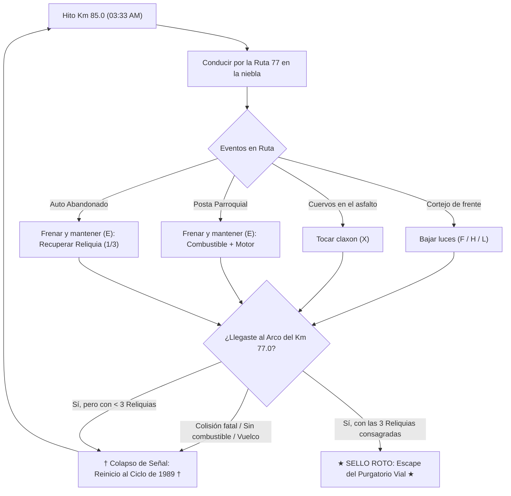

# † KILÓMETRO 77 †

> **Prueba de Concepto (PoC)** — *Survival Driving & Terror Atmosférico PSX/Noir en Godot 4*


> [!IMPORTANT]
> **Estado del Proyecto: En Pausa Temporal (On Hold)**  
> Este repositorio se publica como una **Prueba de Concepto (PoC)** funcional. El desarrollo activo se encuentra **en pausa por un tiempo**, conservando aquí la base jugable, estética y técnica alcanzada hasta ahora junto con la hoja de ruta pendiente para cuando se retome.

---

## Sinopsis

**Octubre de 1989 — 03:33 AM.**  
Eres el conductor de la **Unidad Forense 77**. Tu orden de despacho es trasladar el séptimo féretro sellado del aluvión de la montaña desde el **Hito 85** hasta cruzar el **Gran Arco del Kilómetro 77**.

Pero el asfalto bajo tus ruedas fue sepultado hace décadas. Si alcanzas el Kilómetro 77 sin haber recuperado las **3 Actas Parroquiales (Reliquias)** ocultas en los vehículos siniestrados de la berma —o si tu furgón vuelca, se queda sin combustible o destruye su motor—, el reloj vuelve a marcar las **03:33** y el bucle comienza de nuevo.

---

## Características Principales (PoC)

### 1. Conducción Arcade-Pesada y Derrape Nocturno (`van.gd`)
- **Física con peso e inercia:** Implementación personalizada sobre `CharacterBody3D` y **Jolt Physics** con transferencia de peso visual (cabeceo al frenar/acelerar y balanceo centrífugo en curva).
- **Asfalto húmedo y *Aquaplaning*:** Por encima de los `68 km/h`, los giros bruscos reducen la adherencia lateral obligando a dosificar la dirección o iniciar un derrape controlado.
- **Powerslide con freno de mano (`Espacio`):** Desbloquea el eje trasero para encadenar curvas cerradas de montaña sin perder el impulso longitudinal.
- **Daño mecánico localizado:** Los impactos frontales degradan la salud del motor, sacuden la cámara y pueden romper individualmente los faros delanteros (dejándote a oscuras en plena ruta).

### 2. Generación Procedural de Ruta (`road_manager.gd` & `road_segment.gd`)
- **Streaming infinito por tramos:** Generación y reciclaje dinámico de segmentos de `80m` con rectas, curvas de montaña, desniveles de berma, guardarraíles, hitos kilométricos y alumbrado de vapor de sodio.
- **Escalada hacia el Km 77:** A medida que desciende el kilometraje (`Km 85.0` → `Km 77.0`), la tormenta eléctrica se intensifica y las anomalías viales se vuelven más agresivas.

### 3. Amenazas, Anomalías y Supervivencia (`road_event_spawner.gd`)
- **El Cortejo Negro / Doppelgänger (`oncoming_vehicle.gd`):** Carrozas fúnebres y camiones forestales sin conductor que avanzan en sentido contrario. **Regla de supervivencia:** debes apagar las luces altas (`F`/`H`/`L`) al cruzarte con ellos o el resplandor te cegará y tirará del volante hacia el abismo.
- **Acechador Trasero (`rear_stalker.gd`):** Vehículo fantasma que emerge a gran velocidad desde la niebla trasera —visible a través del espejo retrovisor superior del HUD— intentando embestirte fuera del camino.
- **Presagio de Cuervos (`raven_flock_omen.gd`):** Bandadas de cuervos de ojos carmesí posados sobre la calzada; debes dispersarlos a tiempo haciendo sonar el claxon (`X`).
- **Autos Abandonados y Reliquias (`abandoned_car.gd`):** Sedanes siniestrados con luces interiores parpadeantes. Detenerse junto a ellos y mantener `E` permite recuperar las **3 Reliquias de 1989** necesarias para abrir el Arco del Km 77.
- **Postas Parroquiales (`supply_stop.gd`):** Refugios góticos con surtidores antiguos en la berma donde puedes reabastecer combustible y reparar el motor manteniendo `E`.

### 4. Narrativa Reactiva y Bucle Temporal (`radio_manager.gd` & `loop_reset_manager.gd`)
- **Radio Forense 10-33:** Sistema de transmisiones con ráfagas de estática (`static.aiff`) que reacciona en tiempo real a colisiones, avistamientos del Doppelgänger, recolección de reliquias y al número de ciclos temporales que llevas atrapado.
- **Reinicio Diegético:** Morir o cruzar el Km 77 sin las 3 reliquias no muestra una pantalla genérica de *Game Over*, sino un colapso de señal CRT que rebobina la línea temporal al Hito 85 conservando la memoria narrativa del bucle.

### 5. Estética Retro PSX / Noir (`shaders/psx_retro.gdshader`)
- Downsampling en tiempo real a `960×540`.
- **Matriz de Dithering Bayer 8×8** y cuantización de profundidad de color estilo 16-bit / PSX.
- Desaturación *Noir* selectiva del mundo físico preservando los acentos de fósforo verde, ámbar y rojo sangre en el HUD y las luces emisivas.
- Aberración cromática radial, grano analógico, scanlines y distorsión de cinta VHS durante eventos paranormales.

---

## Ciclo de Juego



---

## Controles

| Acción | Tecla Principal | Alternativa | Uso en Supervivencia |
| :--- | :---: | :---: | :--- |
| **Acelerar** | `W` | `↑` | Avanzar hacia el Hito 77 (consume combustible) |
| **Frenar / Reversa** | `S` | `↓` | Detenerse en postas/autos abandonados o dar marcha atrás |
| **Dirección** | `A` / `D` | `←` / `→` | Esquivar escombros, rocas y tráfico fantasmal |
| **Freno de Mano (Drift)** | `Espacio` | — | Derrapar en curvas cerradas de montaña sin perder velocidad |
| **Turbo de Emergencia** | `Shift` | — | Impulso de `4s` (`12s` de enfriamiento) para huir del Acechador |
| **Luces Altas / Bajas** | `F` | `H` / `L` | **Altas:** ver lejos en la niebla · **Bajas:** cruzar al Doppelgänger sin cegarse |
| **Claxon** | `X` | — | Dispersar bandadas de cuervos antes de impactarlas |
| **Interactuar** | `E` *(mantener)* | — | Inspeccionar autos abandonados (Reliquias) o repostar en Postas |
| **Cámara Frontal / Trasera** | `Q` | — | Alternar vista de persecución |
| **Pausa** | `Esc` | — | Abrir menú de pausa |

---

## Arquitectura del Proyecto

```text
kilometro-77/
├── project.godot              # Configuración del motor (Godot 4, Forward+, Jolt Physics)
├── main_menu.tscn / .gd       # Escena de menú principal con diorama 3D nocturno
├── world.tscn                 # Escena principal: iluminación, niebla volumétrica y nodos raíz
├── van.tscn / .gd             # Física de la Unidad 77, luces, turbo, combustible y daños
├── chase_camera.gd            # Cámara de persecución con FOV dinámico y trauma/shake
├── road_manager.gd            # Generador procedural y reciclador de tramos de ruta
├── road_segment.gd            # Geometría procedural de calzada, curvas, bermas y farolas
├── road_event_spawner.gd      # Spawner de anomalías, obstáculos, capillas y decorado gótico
├── oncoming_vehicle.gd        # IA del Doppelgänger / Cortejo fúnebre en carril contrario
├── rear_stalker.gd            # IA del perseguidor de alta velocidad por retaguardia
├── raven_flock_omen.gd        # Bandadas de cuervos reactivas al claxon
├── abandoned_car.tscn / .gd   # Vehículos siniestrados con las 3 Reliquias del bucle
├── supply_stop.tscn / .gd     # Postas parroquiales de reabastecimiento y reparación
├── storm_controller.gd        # Controlador de relámpagos en doble destello y partículas
├── radio_manager.gd           # Cola de despachos narrativos y alertas por kilometraje
├── loop_reset_manager.gd      # Detección de fallo fatal y reinicio diegético del bucle
├── hud.tscn / .gd             # Telemetría CRT, espejo retrovisor y subtítulos de radio
├── post_process.gd            # Controlador de glitches visuales y aberración en colisiones
├── shaders/
│   ├── psx_retro.gdshader     # Post-procesado Bayer 8x8, pixelación, noir y glitch VHS
│   └── mirror_flip.gdshader   # Inversión horizontal del SubViewport del espejo retrovisor
├── models/                    # Modelos 3D low-poly exportados en formato .glb
└── audio/                     # Audio de motor (engine.flac), estática (static.aiff) y claxon (horn.wav)
```

---

## Lista de Pendientes (TODO — Post-Pausa)

Cuando se retome el desarrollo más allá de esta Prueba de Concepto, estos son los frentes principales por construir y pulir:

### Jugabilidad y Conducción
- [ ] **Vista de cabina en primera persona (1st-Person Interior):** Tablero diegético funcional dentro de la furgoneta con velocímetro analógico, indicador de reliquias en el salpicadero, limpiaparabrisas activos y espejo retrovisor físico integrado al chasis.
- [ ] **Física del féretro en la caja trasera:** Simular el desplazamiento de peso del séptimo féretro en curvas bruscas o frenadas de emergencia (afectando el centro de gravedad de la Unidad 77 si se rompen las cadenas de sujeción).
- [ ] **Variaciones de superficie y clima:** Tramos con barro profundo tras el aluvión, puentes colgantes estrechos, túneles derrumbados y reactivación opcional de aguacero denso con impacto en la visibilidad del parabrisas.
- [ ] **Soporte completo para Gamepad / Volante:** Vibración háptica en impactos, curvas de respuesta analógica para gatillos de acelerador/freno y mapeo de botones en el HUD.

### Terror, Eventos y Mundo
- [ ] **Nuevas anomalías en ruta:**
  - [ ] Siluetas/autoestopistas que reaparecen dentro de la cabina si no mantienes la velocidad o si miras hacia atrás en el momento equivocado.
  - [ ] Desvíos rurales secundarios (*ramales prohibidos*) que actúan como atajos de alto riesgo para hallar reliquias o trampas del bucle.
  - [ ] Procesiones fúnebres completas bloqueando ambas pistas cerca del Km 78.
- [ ] **Cinemática y secuencia final del Arco del Km 77:** Expandir el desenlace verdadero (*True Ending*) al cruzar el Gran Arco con las 3 Actas de 1989 consagradas, mostrando qué ocurrió realmente la noche del derrumbe.
- [ ] **Persistencia entre sesiones:** Guardado automático en disco (`user://`) del contador de bucles, expedientes forenses desbloqueados y mejores tiempos de escape.

### Audio y Ambientación
- [ ] **Actuación de voz (Voice Acting) con filtro de radio:** Voces procesadas para la Central Forense 10-33 e interferencias fantasmales de 1989.
- [ ] **Diseño sonoro espacial 3D (`AudioStreamPlayer3D`):**
  - [ ] Sonido posicional de truenos sincronizado con el doble destello de `storm_controller.gd`.
  - [ ] Campanas parroquiales distantes en las Postas (`supply_stop.gd`) y graznidos 3D en las bandadas de cuervos (`raven_flock_omen.gd`).
  - [ ] Chirrido de neumáticos en derrape (`handbrake`), golpes metálicos de impacto y crujido del chasis.

### Arte, UI y Optimización
- [ ] **Reemplazo de geometría procedural restante:** Modelar y texturizar en estilo PSX low-poly los surtidores, señales viales deterioradas, guardarraíles oxidados y el interior de la furgoneta.
- [ ] **Menú de Opciones:** Ajustes de volumen (Master / Motor / Radio / SFX), sensibilidad de dirección, intensidad del filtro CRT/PSX y selector de resolución/pantalla completa.
- [ ] **Object Pooling para tramos de carretera:** Reutilizar instancias de `RoadSegment` y props de `RoadEventSpawner` en memoria en lugar de instanciar/liberar nodos en cada tramo para eliminar micro-pausas de recolección de basura.

---

## Requisitos y Ejecución

1. Instala **Godot Engine 4.6+** (compatible con **Godot 4.7 Forward+** y motor físico **Jolt Physics** integrado).
2. Clona el repositorio:
   ```bash
   git clone https://github.com/sebavidal10/km77.git
   cd km77
   ```
3. Abre Godot, selecciona **Import** y elige el archivo `project.godot`.
4. Presiona **F5** (o el botón *Run Project*) para iniciar desde `main_menu.tscn`.
